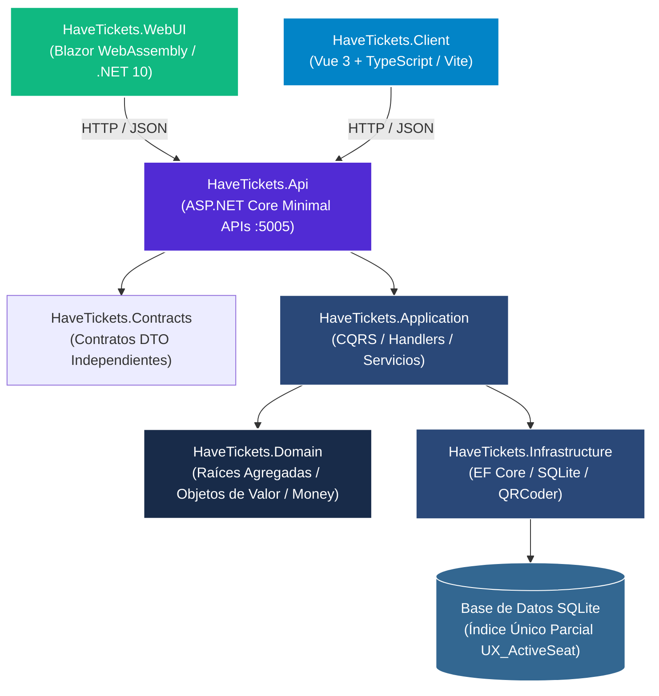

<picture>
  <source media="(prefers-color-scheme: dark)" srcset="docs/assets/banner-dark.svg">
  <source media="(prefers-color-scheme: light)" srcset="docs/assets/banner-light.svg">
  
</picture>

# HaveTickets — Plataforma de Venta de Entradas y Reserva de Cines

[](README.md)
[](README.es.md)
[](https://github.com/Nain9Dev/HaveTickets/actions/workflows/ci.yml)
[](https://github.com/Nain9Dev/HaveTickets/actions/workflows/codeql.yml)
[](https://tickets.naindev.com/)
[](https://status.naindev.com)
[](https://github.com/Nain9Dev/engineering-handbook)
[](https://github.com/Nain9Dev/engineering-handbook/blob/main/governance/zero-cost-philosophy.md)
[](HaveTickets.Api.Tests/ArchitectureTests.cs)
[](https://codespaces.new/Nain9Dev/HaveTickets)
[](HaveTickets.Domain.Tests/)
[](https://tickets.naindev.com/)

**Demo Online Interactiva:** [https://tickets.naindev.com/](https://tickets.naindev.com/) (Blazor WebAssembly en cliente con motor determinista de asignación de butacas, coste 0,00 €)

Una plataforma determinista de venta de entradas y reserva de butacas de alta concurrencia construida con .NET 10, Clean Architecture y doble frontend (Blazor WebAssembly y Vue 3 + TypeScript).

Forma parte del portafolio técnico de **NainDev**.

---

## Características

- **Asignación Determinista de Butacas**: Evita condiciones de carrera y sobreventa en la capa de datos mediante índices únicos parciales (`UX_Tickets_ShowtimeId_Seat_Active`).
- **Contabilidad Exacta en Unidades Menores**: Elimina imprecisiones de coma flotante y truncado de céntimos utilizando aritmética entera de unidades menores (`Money`).
- **Ciclo de Vida Unidireccional de Entradas**: Progresión de estado estricta (`Issued` -> `CheckedIn` | `Cancelled`) con liberación automática de butaca ante cancelación.
- **Validación de Acceso en Torno**: Ventana de validación idempotente [-30m, +30m] con resultados de admisión tipados.
- **Generación Dinámica de Códigos QR**: Endpoint de renderizado PNG para códigos de confirmación con codificación determinista de bytes.
- **Hardening de API**: Rate limiting de ventana fija particionado por IP, lista blanca CORS, `ProblemDetails` RFC 7807 y documentación Scalar OpenAPI.
- **Frontend Dual**:
  - **Vue 3 + TypeScript**: Mapa interactivo de selección de butacas, dark glassmorphism, cartera de entradas y consola de escaneo de accesos.
  - **Blazor WebAssembly**: Cliente consumidor .NET 10.

---

## Arquitectura y Diagrama C4 de Contenedores



### Proyectos de la Solución

```
HaveTickets.slnx
├── HaveTickets.Contracts          # Contratos DTO independientes (V1)
├── HaveTickets.Domain             # Dominio empresarial puro: entidades, agregados, reglas
├── HaveTickets.Application        # Casos de uso CQRS: handlers, queries, comandos
├── HaveTickets.Infrastructure     # EF Core, persistencia SQLite, modelos de lectura, QR
├── HaveTickets.Api                # Minimal APIs, Scalar OpenAPI, rate limiting
├── HaveTickets.Domain.Tests       # xUnit v3 + Shouldly + CsCheck (Property-Based Testing)
├── HaveTickets.Api.Tests          # Suite de integración en memoria + guardarraíles NetArchTest
├── HaveTickets.WebUI              # Cliente Blazor WebAssembly
└── HaveTickets.Client             # Cliente Vue 3 + TypeScript con Vite
```

---

## Desarrollo Local y Puertos

Puertos estrictamente definidos en `D:/Development/Tools/dev-ports.json`:

| Servicio | Puerto | Comando de Inicio |
| :--- | :--- | :--- |
| **API** | `8190` | `$env:ASPNETCORE_URLS='http://localhost:8190'; dotnet run --project HaveTickets.Api --no-launch-profile` |
| **Cliente Vue 3** | `5391` | `npm --prefix HaveTickets.Client run dev` |
| **Blazor WebUI** | `5390` | `$env:ASPNETCORE_URLS='http://localhost:5390'; dotnet run --project HaveTickets.WebUI --no-launch-profile` |

La documentación de la API se sirve en: `http://localhost:8190/docs` (Scalar UI) y `http://localhost:8190/openapi/v1.json`.

---

## Pruebas

```powershell
# Compilar la solución bajo la regla estricta de cero advertencias
dotnet build HaveTickets.slnx -warnaserror

# Ejecutar pruebas unitarias de dominio y basadas en propiedades (74 pruebas)
dotnet test HaveTickets.Domain.Tests/HaveTickets.Domain.Tests.csproj --no-build

# Ejecutar pruebas de integración de API (42 pruebas)
dotnet test HaveTickets.Api.Tests/HaveTickets.Api.Tests.csproj --no-build

# Compilar y validar el cliente Vue 3 + TypeScript
npm --prefix HaveTickets.Client run build
```

---

## FinOps y Arquitectura de Coste Cero (0,00 €)

En consonancia con la [Filosofía de Infraestructura de Coste Cero de NainDev](https://github.com/Nain9Dev/engineering-handbook/blob/main/governance/zero-cost-philosophy.md), este sistema opera con un coste recurrente en la nube estrictamente de **0,00 €/mes**.

---

## Licencia

MIT — ver [`LICENSE`](LICENSE).
