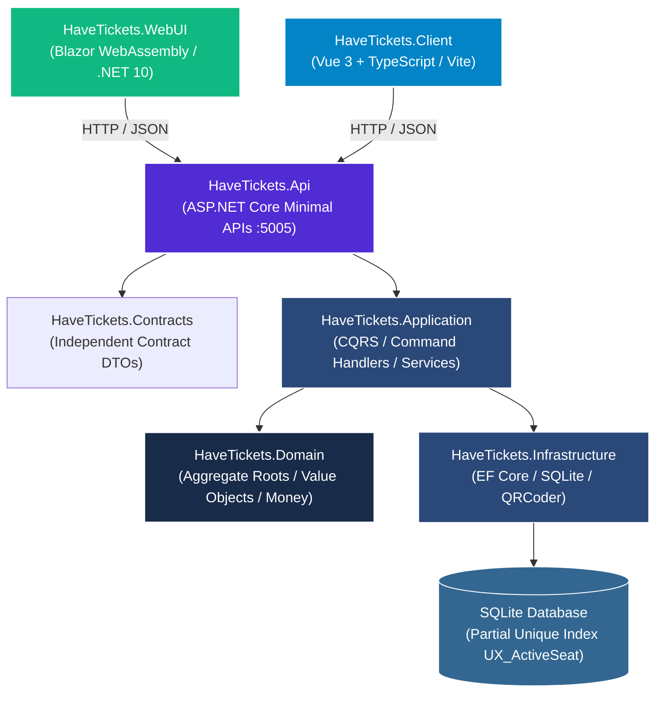

<picture>
  <source media="(prefers-color-scheme: dark)" srcset="docs/assets/banner-dark.svg">
  <source media="(prefers-color-scheme: light)" srcset="docs/assets/banner-light.svg">
  
</picture>

[](README.md)
[](README.es.md)
[](https://github.com/Nain9Dev/HaveTickets/actions/workflows/ci.yml)
[](https://github.com/Nain9Dev/HaveTickets/actions/workflows/codeql.yml)
[](https://tickets.naindev.com/)
[](https://status.naindev.com)
[](https://github.com/Nain9Dev/engineering-handbook)
[](https://github.com/Nain9Dev/engineering-handbook/blob/main/governance/zero-cost-philosophy.md)
[](HaveTickets.Api.Tests/ArchitectureTests.cs)
[](https://codespaces.new/Nain9Dev/HaveTickets)
[](HaveTickets.Domain.Tests/)
[](https://tickets.naindev.com/)

**Demo Online Interactiva:** [https://tickets.naindev.com/](https://tickets.naindev.com/) (Blazor WebAssembly en cliente con motor determinista de asignación de butacas, coste 0,00 €)

A deterministic, high-concurrency cinema ticketing and seat reservation platform built with .NET 10, Clean Architecture, and dual frontends (Blazor WebAssembly and Vue 3 + TypeScript).

Part of the **NainDev** engineering portfolio.

---

## Features

- **Deterministic Seat Allocation**: Prevents overbooking race conditions at the database layer via partial unique indices (`UX_Tickets_ShowtimeId_Seat_Active`).
- **Exact Minor-Unit Accounting**: Eliminates floating-point drift and cent truncation using integer minor-unit arithmetic (`Money`).
- **One-Way Ticket Lifecycle**: Strict status progression (`Issued` -> `CheckedIn` | `Cancelled`) with automated seat release on cancellation.
- **Turnstile Door Validation**: Idempotent check-in window [-30m, +30m] with typed admission outcomes.
- **Dynamic QR Code Generation**: PNG render endpoint for ticket confirmation codes using lightweight deterministic byte encoding.
- **API Hardening**: Fixed-window rate limiting partitioned by client IP, CORS whitelisting, RFC 7807 `ProblemDetails`, and Scalar OpenAPI documentation.
- **Dual Frontend**:
  - **Vue 3 + TypeScript**: Interactive seat selection map, dark glassmorphism, holder ticket wallet, and door scanner console.
  - **Blazor WebAssembly**: .NET 10 client consumer.

---

## Architecture & C4 Container Diagram



### Solution Projects

```
HaveTickets.slnx
├── HaveTickets.Contracts          # Independent contract DTOs (V1)
├── HaveTickets.Domain             # Pure enterprise domain: entities, aggregates, rules
├── HaveTickets.Application        # CQRS use cases: handlers, queries, commands
├── HaveTickets.Infrastructure     # EF Core, SQLite persistence, read models, QR generation
├── HaveTickets.Api                # Minimal APIs, Scalar OpenAPI, rate limiting
├── HaveTickets.Domain.Tests       # xUnit v3 + Shouldly + CsCheck (Property-Based Testing)
├── HaveTickets.Api.Tests          # In-memory integration suite + NetArchTest guardrails
├── HaveTickets.WebUI              # Blazor WebAssembly client
└── HaveTickets.Client             # Vue 3 + TypeScript Vite client
```

---

## Local Development & Ports

Ports strictly adhere to `D:/Development/Tools/dev-ports.json`:

| Service | Port | Launch Command |
| :--- | :--- | :--- |
| **API** | `8190` | `$env:ASPNETCORE_URLS='http://localhost:8190'; dotnet run --project HaveTickets.Api --no-launch-profile` |
| **Vue 3 Client** | `5391` | `npm --prefix HaveTickets.Client run dev` |
| **Blazor WebUI** | `5390` | `$env:ASPNETCORE_URLS='http://localhost:5390'; dotnet run --project HaveTickets.WebUI --no-launch-profile` |

API documentation is served at: `http://localhost:8190/docs` (Scalar UI) and `http://localhost:8190/openapi/v1.json`.

---

## Testing

```powershell
# Build solution under strict zero-warning rule
dotnet build HaveTickets.slnx -warnaserror

# Run Domain Unit & Property-Based Tests (74 tests)
dotnet test HaveTickets.Domain.Tests/HaveTickets.Domain.Tests.csproj --no-build

# Run API Integration Tests (42 tests)
dotnet test HaveTickets.Api.Tests/HaveTickets.Api.Tests.csproj --no-build

# Build and validate Vue 3 + TypeScript client
npm --prefix HaveTickets.Client run build
```

---

## Architecture Documentation

See [docs/00-architecture-and-ticketing-invariants.md](docs/00-architecture-and-ticketing-invariants.md) for detailed analysis of the domain invariants, database concurrency controls, and failure mode guarantees.

---

## FinOps & Zero-Cost Architecture (0.00 €)

<details>
<summary><b>Inspect 0.00 € Infrastructure Topology &amp; Governance</b></summary>

In alignment with the [NainDev Zero-Cost Infrastructure Philosophy](https://github.com/Nain9Dev/engineering-handbook/blob/main/governance/zero-cost-philosophy.md), this system operates at strictly **0.00 €/month** recurring cloud cost:

| Component | Architecture Mechanism | Provider / Runtime | Monthly Cost |
|:---|:---|:---|:---|
| **Global Edge Delivery** | Anycast CDN, HTTP/3, TLS termination &amp; DDoS mitigation | Cloudflare Free Tier | 0.00 € |
| **Client Application Shell** | Zero-dependency static Blazor WASM &amp; Vue 3 assets | GitHub Pages / Edge CDN | 0.00 € |
| **Compute Execution** | Deterministic browser WebAssembly evaluation &amp; SQLite in-memory | Client WASM Engine | 0.00 € |
| **CI/CD Quality Gate** | Continuous integration, NetArchTest enforcement &amp; security scans | GitHub Actions (Linux Runner) | 0.00 € |
| **Total Recurring Cost** | **Zero billable cloud dependencies** | | **0.00 €** |

</details>

