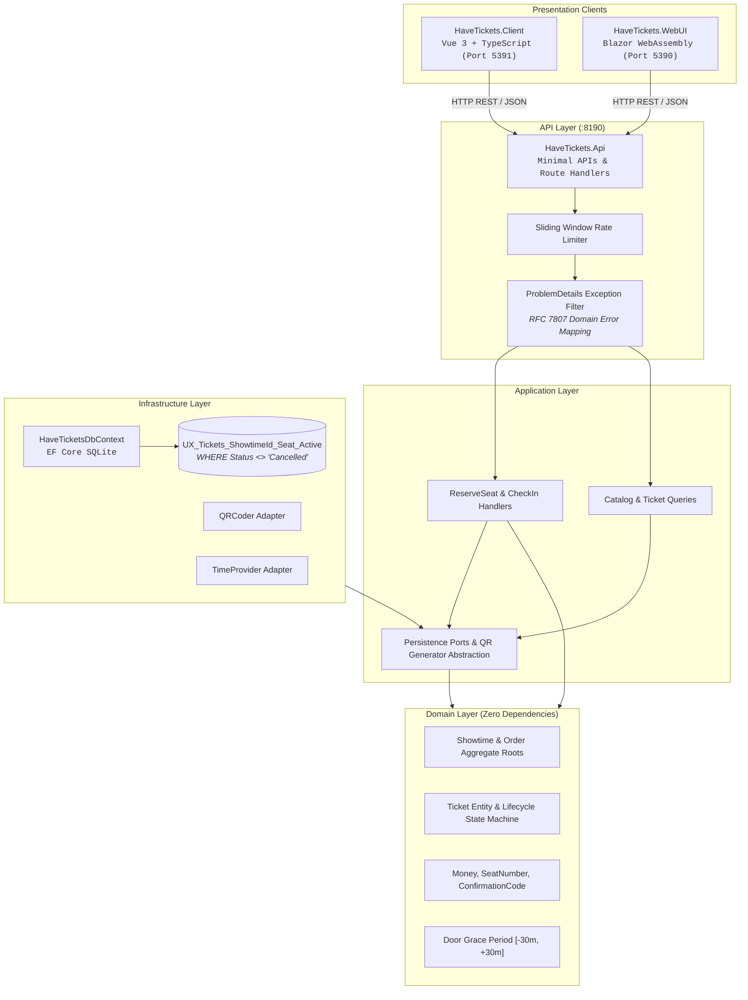

# Architecture Specification — HaveTickets

## System Topology & C4 Architecture

HaveTickets is organized as a modular Clean Architecture system backed by an SQLite relational persistence layer with partial unique constraint enforcement.



---

## Layer Separation & Responsibilities

```text
HaveTickets.slnx
├── HaveTickets.Contracts          # Independent DTOs and API boundary contracts (V1)
├── HaveTickets.Domain             # Pure enterprise domain: entities, aggregates, value objects, rules
├── HaveTickets.Application        # CQRS use cases: handlers, queries, commands, abstractions
├── HaveTickets.Infrastructure     # EF Core, SQLite persistence, migrations, read models, QR generator
├── HaveTickets.Api                # Minimal APIs, Scalar OpenAPI, rate limiting, ProblemDetails
├── HaveTickets.Domain.Tests       # xUnit v3 + Shouldly + CsCheck (Property-Based Testing)
├── HaveTickets.Api.Tests          # Isolated in-memory WebApplicationFactory integration suite
├── HaveTickets.WebUI              # Blazor WebAssembly frontend (Port 5390)
└── HaveTickets.Client             # Vue 3 + TypeScript Vite frontend (Port 5391)
```

### Dependency Inversion Rules
1. **Domain Purity**: `HaveTickets.Domain` contains no dependencies on EF Core, ASP.NET Core, or external packages. All validations and business rules execute in-memory.
2. **Contract Decoupling**: `HaveTickets.Contracts` provides serializable request/response DTOs shared between the API Gateway and frontend clients, insulating domain aggregates from serialization formats.
3. **Database Concurrency Arbiter**: Concurrency guarantees rely on database engine semantics:
   ```sql
   CREATE UNIQUE INDEX "UX_Tickets_ShowtimeId_Seat_Active"
   ON "Tickets" ("ShowtimeId", "Seat")
   WHERE "Status" <> 'Cancelled';
   ```
4. **Time Decoupling**: All time inspections utilize `System.TimeProvider` rather than static `DateTime.UtcNow`, guaranteeing 100% deterministic test execution.
