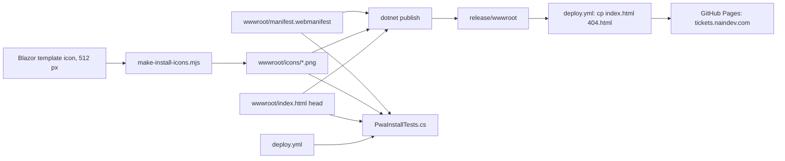

# Implementation plan: Installable site (Android and iOS)

Status: Implemented on `feat/pwa-install-tickets`, not merged

## Modules

- **Manifest**: `HaveTickets.WebUI/wwwroot/manifest.webmanifest`, a static file. `dotnet publish` copies
  `wwwroot/` to `release/wwwroot/`, the folder the deploy workflow uploads to GitHub Pages. Covers REQ-TKT-016
  and REQ-TKT-017.
- **Icons**: `HaveTickets.WebUI/wwwroot/icons/`, four PNG files rendered once and committed (see "Icons"
  below). Covers REQ-TKT-017 and REQ-TKT-018.
- **Head tags**: `HaveTickets.WebUI/wwwroot/index.html`, the only HTML document of the site, right after the
  favicon link and therefore after `<base href="/">`. The deploy workflow copies the published `index.html` to
  `404.html`, so the single-page fallback carries the same head. Covers REQ-TKT-018.
- **Guard**: `HaveTickets.Api.Tests/PwaInstallTests.cs`, next to `SeoBaselineTests.cs`, in the test step
  `ci.yml` already runs. Covers REQ-TKT-016 to REQ-TKT-018.



## Data model changes

None.

## Key decisions

- **Decision**: a static manifest with `./` paths, linked as `manifest.webmanifest`.
  - **Discarded alternative**: root-absolute `/` paths.
  - **Rationale**: the page is one document that loads its assets relative to `<base href="/">`, the Blazor
    convention. Both forms resolve to the same URLs on this host, and `id` resolves to the site root.
- **Decision**: no service worker.
  - **Discarded alternative**: the service worker of the Blazor template (`dotnet new blazorwasm --pwa`).
  - **Rationale**: Chrome and iOS install without one, and a cache can keep serving an old build of the demo.
    Owner decision of 2026-11-13. Adding one later needs its own decision record.
- **Decision**: render the icons from the artwork of the existing favicon, in its 512 px original.
  - **Discarded alternative**: scaling the 192 px favicon up (the 512 px icons come out visibly jagged), or
    drawing a mark for the product.
  - **Rationale**: the site has no mark of its own and this change must not invent one. The favicon is the
    stock icon of the Blazor WebAssembly template, and the same template ships it at 512 px.
- **Decision**: the status bar style is `black`.
  - **Discarded alternative**: `black-translucent`.
  - **Rationale**: the translucent style draws the page under the status bar and needs safe-area insets that
    the ecosystem bar and the navbar do not have.
- **Decision**: the test reads the repository tree and takes the icon sizes from the PNG header.
  - **Discarded alternative**: testing a publish output, or decoding the pixels with an image library.
  - **Rationale**: `ci.yml` builds and tests but does not publish, and the repository has no image library;
    the change adds no CI step and no dependency. The pixel rules (opaque tiles, maskable safe zone) are
    checked when the icons are rendered.

## Icons

HaveTickets had no mark of its own: its favicon was the stock icon of the Blazor WebAssembly project
template. The owner chose a monogram on 2026-11-14: the letters HT drawn with round strokes on the page
background (`#0a0a0f`), the H in the text colour (`#f8fafc`) and the T in the accent colour (`#8b5cf6`).
`wwwroot/favicon.svg` is that mark and the source of every icon; it replaces the template icon as the
favicon of the page, and `wwwroot/icon-192.png` is removed.

```bash
node make-install-icons.mjs --source HaveTickets.WebUI/wwwroot/favicon.svg \
  --out HaveTickets.WebUI/wwwroot/icons --bg "#0a0a0f" --maskable-scale 0.95 --apple-scale 1
```

`make-install-icons.mjs` is the icon renderer shared by the install rollout of the ecosystem. It is not part
of this repository and adds no dependency to it. It writes:

| File | Pixels | Content |
| :--- | :--- | :--- |
| `icon-192.png`, `icon-512.png` | 192, 512 | The mark as drawn, rounded tile included (purpose `any`). |
| `icon-maskable-512.png` | 512 | Opaque `#0a0a0f` tile with the mark centred at 95% of the width. The strokes end 35.4% of the width from the centre, inside the 40% safe zone. |
| `apple-touch-icon.png` | 180 | Opaque `#0a0a0f` tile with the mark at full size. |

`#0a0a0f` is the tile colour of the mark, so the tile blends into the background. To replace the monogram
with a definitive logo, pass it as `--source` and adjust `--bg` and the two scales. The manifest, the head
tags and the test do not change.

## Test strategy

- Contract test (xUnit, `PwaInstallTests.cs`): the manifest members and exact names, the three declared icons
  and the Apple icon at their declared size (PNG header), the head tags of `index.html` and their position
  after `<base>`, and the deploy step that copies `index.html` to `404.html`.
- When the icons are rendered, on the folder `dotnet publish` writes: the shared install check
  (`verify-install.mjs`: manifest, icon sizes, opaque tiles, maskable safe zone, head tags of `index.html` and
  `404.html`) and Chrome's `Page.getInstallabilityErrors` on a loopback copy of that folder.
- Manual, after the deploy: the media type of the live manifest, then the owner's Android phone and iPhone.
